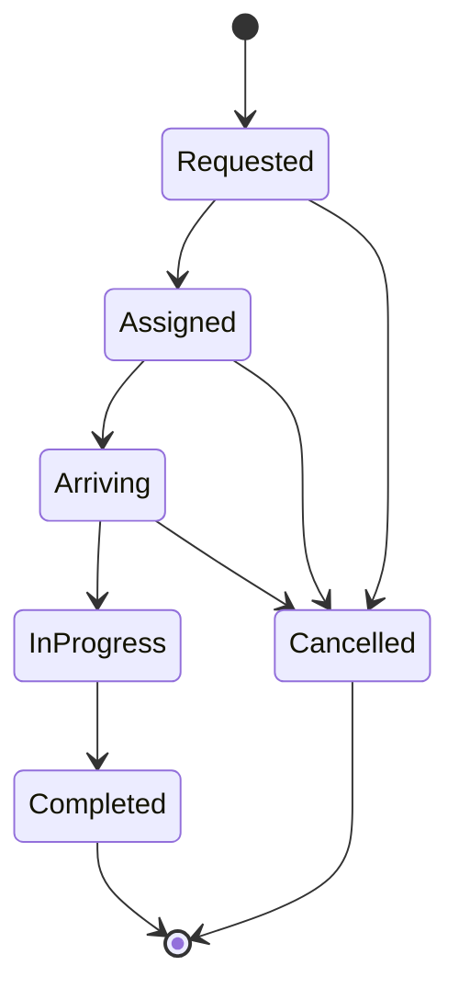

# RideFlow

A C++17 ride-hailing engine demonstrating fleet management, safe driver matching, deterministic trip lifecycles, dynamic surge pricing, and asynchronous trip notifications.

This repository contains a new, standalone implementation based on the RideFlow project description. It is an in-memory simulation and reusable library, with a console demo and automated tests.

## Features

- **Fleet management:** register drivers, update locations, inspect availability, and release drivers after completion or cancellation.
- **Thread-safe matching:** `std::shared_mutex` protects fleet reads and writes; the booking coordinator serializes booking and lifecycle mutations to prevent double assignment.
- **State pattern:** dedicated state objects allow only valid trip transitions.
- **Strategy pattern:** inject dispatch and pricing implementations through small interfaces. Defaults select the nearest driver and calculate capped surge fares.
- **Observer pattern:** a FIFO background worker delivers immutable trip snapshots without running subscriber code under engine or fleet locks.
- **RAII ownership:** standard containers, smart pointers, scoped locks, and a joining worker thread manage resource lifetimes.

## Build and run

Requires a C++17 compiler and platform thread support. No external C++ libraries are required.

### CMake

Install CMake 3.16 or newer, then run:

```sh
git clone https://github.com/cgoyal23/RideFlow.git
cd RideFlow
cmake -S . -B build -DCMAKE_BUILD_TYPE=Debug
cmake --build build --config Debug --parallel
ctest --test-dir build -C Debug --output-on-failure
```

Run the demo on macOS/Linux:

```sh
./build/rideflow_demo
```

With Visual Studio's multi-configuration generator on Windows:

```powershell
.\build\Debug\rideflow_demo.exe
```

### Make on macOS/Linux

A smaller alternative that does not require CMake:

```sh
make
make test
./build/rideflow_demo
```

Expected demo output:

```text
Trip #1 | requested | driver driver-001 | INR 100.00
Trip #1 | assigned | driver driver-001 | INR 100.00
Trip #1 | arriving | driver driver-001 | INR 100.00
Trip #1 | in_progress | driver driver-001 | INR 100.00
Trip #1 | completed | driver driver-001 | INR 100.00
```

## Using the library

```cpp
#include "rideflow/engine.hpp"

rideflow::Engine engine;
engine.fleet().add("driver-1", {0, 0});
auto trip = engine.book("rider-1", {1, 0}, {4, 4});
engine.advance(trip.id, rideflow::Status::Arriving);
engine.advance(trip.id, rideflow::Status::InProgress);
engine.advance(trip.id, rideflow::Status::Completed);
engine.flushEvents();
```

Locations use Cartesian coordinates measured in kilometres. The demo's `(1, 0)` to `(4, 4)` journey is 5 km. These coordinates are not latitude and longitude.

## Architecture and design patterns

| Component | Responsibility | Design choice |
| --- | --- | --- |
| `Engine` | Booking, trip records, lifecycle coordination | Depends on dispatch and pricing abstractions |
| `Fleet` | Driver locations and availability | Shared read locks, exclusive mutation locks |
| `TripState` | Legal next states | State objects for each lifecycle stage |
| `DispatchStrategy` | Driver selection | Replaceable nearest-driver implementation |
| `PricingStrategy` | Fare calculation | Replaceable capped surge implementation |
| `TripObserver` | Reacting to updates | Weak subscriptions and asynchronous delivery |
| `EventDispatcher` | Ordered event delivery and shutdown | FIFO queue and RAII worker |

Responsibilities are separated behind small interfaces. Dispatch and pricing can be extended without editing booking logic; observers depend only on trip events. For example, construct an engine with your own implementations:

```cpp
auto dispatch = std::make_shared<MyDispatchStrategy>();
auto pricing = std::make_shared<MyPricingStrategy>();
rideflow::Engine engine(dispatch, pricing);
```

Derive those classes from `DispatchStrategy` and `PricingStrategy` and implement their virtual methods. The tests include working alternative strategies.

### Trip lifecycle



`book()` immediately matches an available driver and returns an assigned trip. Requested and assigned snapshots are queued in that order for observers; the requested snapshot already includes the selected driver and quoted fare. If no driver is available, booking throws without creating a trip. There is no waiting-request queue. Requested-to-cancelled is supported by the state model but is not exposed as a separate public booking step.

Completion moves the driver to the destination and restores availability. Cancellation before pickup restores availability while retaining the driver's latest known location. Cancelling an in-progress trip, skipping states, or changing a terminal trip throws `std::logic_error`.

### Dispatch and pricing

Nearest dispatch uses Euclidean distance from the driver to pickup. Equal distances are resolved by lexicographic driver ID for deterministic results.

The default fare, in INR, is:

```text
base fare       = 40
per km          = 12
current demand  = active trips + the incoming request
current supply  = available drivers before assignment
multiplier      = clamp(demand / max(supply, 1), 1, 3)
fare            = round((base fare + per km * distance) * multiplier, 2 decimals)
```

Surge changes with booking-time demand and supply; the quoted fare remains fixed throughout a trip. Defaults can be configured through `SurgePricing(baseFare, perKm, maxMultiplier)`.

### Concurrency and ownership

- Each booking and trip transition holds the engine mutex. Driver reservation is performed under an exclusive fleet lock. Concurrent requests cannot reserve the same driver twice.
- Fleet queries use shared locks and return value snapshots. Location updates use exclusive locks.
- Lock ordering is engine, then fleet. Observer callbacks run on the dispatcher worker after its queue lock is released, so callbacks may query engine state.
- Strategy methods run during a booking under the engine mutex. They must not call back into that engine. Strategies shared across engines must support concurrent calls.
- Keep a `shared_ptr` to each observer while subscribed; expired observers are removed automatically. Callback exceptions are isolated, counted by `observerFailures()`, and do not stop delivery to other observers.
- `flushEvents()` waits until the worker is idle; call it after producers finish for a stable barrier. Calling it from a callback throws instead of deadlocking.
- Destruction drains pending events and joins the worker. Stop concurrent callers before destroying the engine. Observers must not destroy their engine from inside a callback. Callbacks must finish for shutdown to complete.

## Tests

The test executable checks:

- Nearest-driver tie-breaking, trip completion, driver relocation, and driver availability.
- Invalid transitions, terminal states, missing trips, duplicate drivers, invalid inputs, and unavailable capacity.
- Cancellation from assigned and arriving states.
- Base fares, demand-based surge, surge caps, and interchangeable dispatch/pricing strategies.
- 96 concurrent requests competing for 24 drivers, with unique trip IDs and no duplicate driver assignments.
- FIFO asynchronous notifications, subscriber failure isolation, and draining shutdown.

GitHub Actions is configured to build and test with CMake on Linux, macOS, and Windows, plus a Linux ThreadSanitizer job. Those CI results are separate from local test results.

To run local address and undefined-behavior checks with Clang or GCC:

```sh
c++ -std=c++17 -g -O1 -pthread -fsanitize=address,undefined \
  -fno-omit-frame-pointer -Iinclude src/engine.cpp tests/engine_tests.cpp \
  -o build/rideflow_sanitized
./build/rideflow_sanitized
```

## Repository layout

```text
.github/workflows/ci.yml    Cross-platform build and concurrency checks
include/rideflow/engine.hpp Public models and interfaces
src/engine.cpp             Fleet, lifecycle, dispatch, pricing, event worker
examples/demo.cpp          Complete trip with console notifications
tests/engine_tests.cpp     Behavioral and concurrency tests
CMakeLists.txt             Library, demo, and CTest targets
Makefile                   Direct compiler build for macOS/Linux
```

## Scope and limitations

This is a single-process educational engine. Trips and drivers are held in memory. It does not include a web UI, HTTP service, persistent database, GPS routing, payments, or production deployment. The engine serializes booking mutations for correctness; it is not a distributed matching system or a throughput benchmark. The event queue and trip history are unbounded, and observer delivery is best effort within the process, without durable replay or crash recovery. Allocation failure recovery is not transactional. Fares use floating-point arithmetic for demonstration rather than financial accounting.
